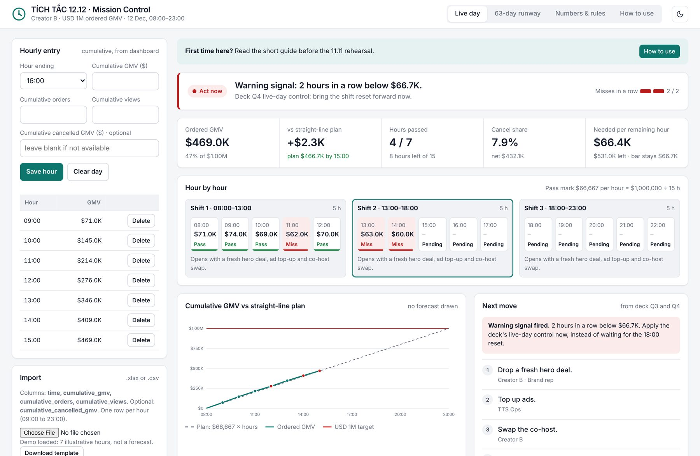
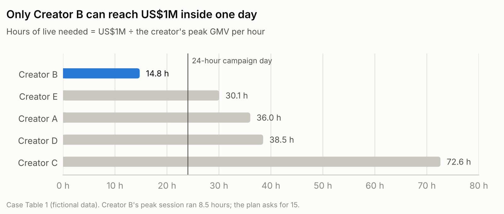
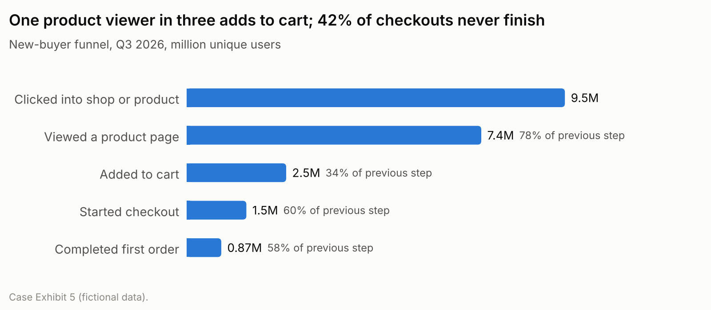
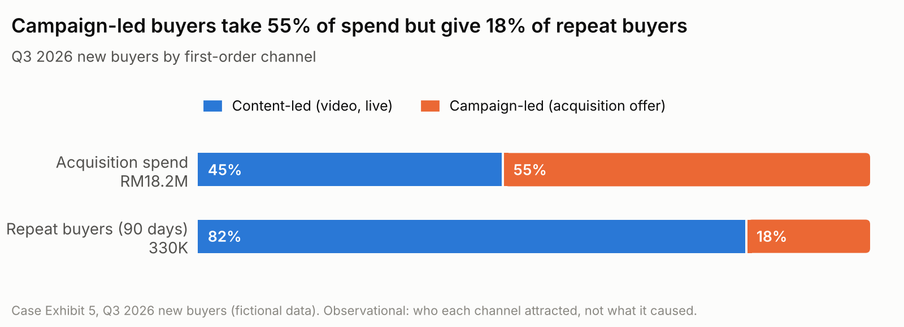
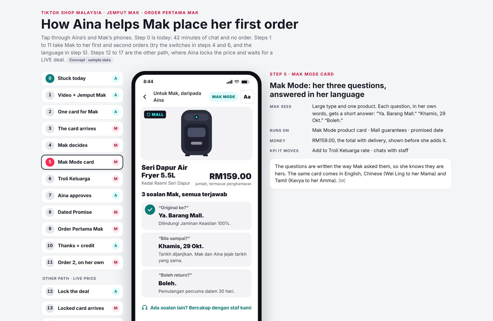
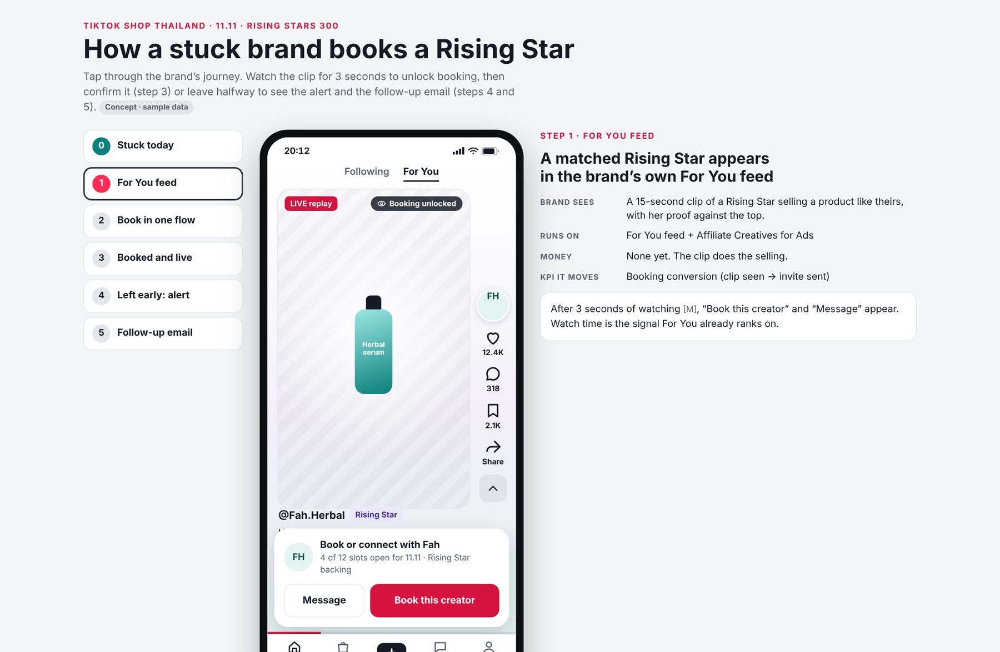
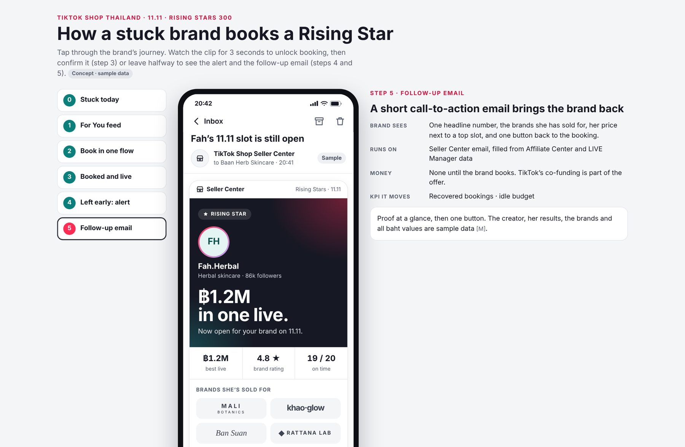
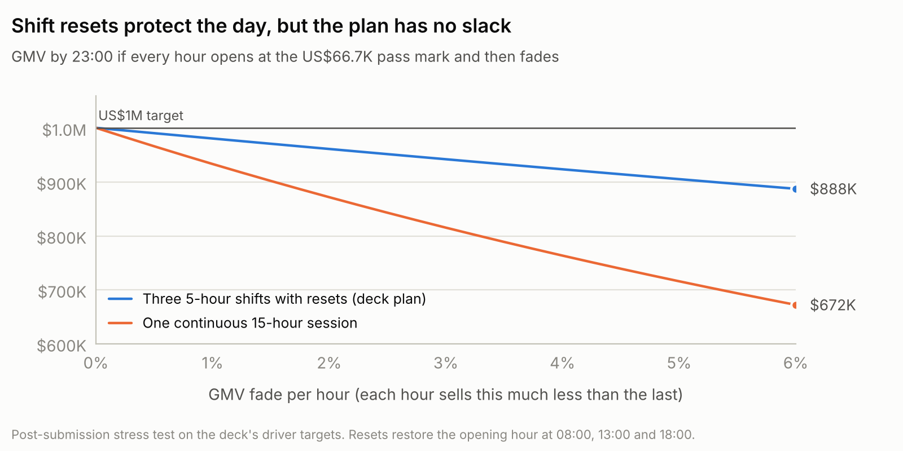
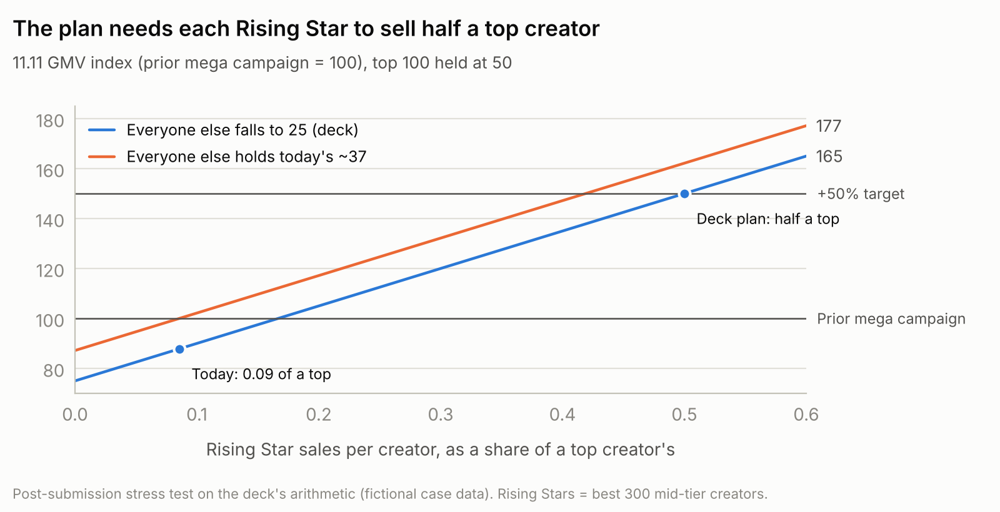

# TikTok Shop Southeast Asia Regional Case Challenge 2026

**Three markets, three ways to take GMV apart.** Case work by Rachel Tran for the 2026 Southeast Asia case challenge run by TikTok APAC Early Careers: a single-creator US$1M livestream in Vietnam, a wallet-share plan in Malaysia and an 11.11 creator plan in Thailand.

**[Case study page](https://racheltran184.github.io/tiktok-shop-sea-case-challenge/)** · **[Notebook: every deck number rebuilt in Python](analysis/case_numbers.ipynb)** · [Portfolio](https://racheltran.vercel.app/)



## The three cases at a glance

| | Vietnam, 12.12 | Malaysia | Thailand, 11.11 |
|---|---|---|---|
| **Brief** | Take one emerging creator to US$1M GMV in one livestream day, without aggressive subsidy | Win more of Malaysian shoppers' wallet in 12 months, with headcount for one segment pilot | Hit +50% GMV against the last mega campaign while top creators are half sold out |
| **How GMV breaks down** | views × orders per 1,000 views × AOV | buyers × orders per buyer × basket | top 100 + 300 Rising Stars + everyone else |
| **What the numbers said** | Only Creator B reaches US$1M inside a day (14.8 h); with conversion and AOV held at B's peak, the gap is +74% views | Campaign-led buyers cost RM163 per repeat customer vs RM31 for content-led, yet take 55% of spend; 41+ shoppers order least (44 a year) with the biggest basket (RM39) | Mid-tier traffic sells at 1.00 GMV per traffic point vs 0.60 in the long tail, and 70% of mid creators have no deal |
| **What we proposed** | 63-day, five-phase runway with a warning signal and owner per phase; go/no-go at US$68K an hour on 11.11 | Reach parents through their children; a three-arm test with pre-set scale, iterate and stop rules | Keep the top's half; give the best 300 mid creators the top's terms; 50 + 75 + 25 = 150 |
| **What I built** | [Mission Control](https://racheltran184.github.io/tiktok-shop-sea-case-challenge/prototypes/vietnam-mission-control/): hourly pass mark, two-miss trigger, weakest-driver call, Excel in and out | [Two-phone journey](https://racheltran184.github.io/tiktok-shop-sea-case-challenge/prototypes/malaysia-order-pertama-mak/): 18 steps, Mak Mode in four languages | [Brand journey](https://racheltran184.github.io/tiktok-shop-sea-case-challenge/prototypes/thailand-rising-stars/) from For You feed to booking, plus the scorecards |
| **Deck** | [PDF](decks/vietnam-12-12-trust-in-every-click.pdf) | [PDF](decks/malaysia-order-pertama-mak.pdf) | [PDF](decks/thailand-rising-stars-300.pdf) |

## Vietnam: running the day against a fixed bar

The plan needs US$1M in 15 hours, so every hour must make **US$66,667**. Mission Control checks each completed hour against that bar, shows *Watch* after one miss and *Act now* after two in a row, splits the hour into views, orders per 1,000 views and AOV to name the weakest driver, and shows the move and owner the team agreed before the day. Every rule runs in code, so the same data always gives the same answer; missing hours show as unknown, never as zero.



## Malaysia: frequency and trust, not reach





The pilot reaches shoppers aged 41+ ("Mak") through their children: one product card with the total price, delivery date and protections, the parent's consent, and a 24-hour price lock instead of a new discount.



## Thailand: the top's terms for the best 300 mid-tier creators



A brand that starts a booking and leaves gets one follow-up, naming the creator it chose: one headline number, her price next to a top slot, and one button back.



## The notebook: rebuild, check, stress-test

[`analysis/case_numbers.ipynb`](analysis/case_numbers.ipynb) recomputes the headline figures of all three decks from the case exhibits and checks each against the deck: **50 of 50 reproduce within rounding**. It then stress-tests the assumption each plan leans on hardest.

| Stress test | Finding |
|---|---|
| Vietnam: hourly GMV fades during a 15-hour live | A 2% fade per hour costs about US$39K with shift resets and US$128K without. The pass mark should follow the 11.11 rehearsal's real hourly shape, not a straight line. |
| Malaysia: activation and capture assumptions | Year-1 GMV ranges RM80–160M across 5–10% activation and 50–100% capture; every cell clears RM80M. |
| Thailand: what each Rising Star must sell | The plan needs each Rising Star at half a top creator, a 5.8× lift on today. Without it 11.11 lands near 88, below the last campaign, so the 4 November checkpoint needs a rule to hand the budget back. |





### Run it

```bash
pip install -r requirements.txt
jupyter notebook analysis/case_numbers.ipynb
```

## Repository

```
index.html                 case-study page (GitHub Pages root)
prototypes/                three self-contained HTML prototypes
  vietnam-mission-control/
  malaysia-order-pertama-mak/
  thailand-rising-stars/
analysis/                  notebook, chart style, figures
decks/                     our three solution decks (PDF)
media/                     pitch videos and posters
docs/screenshots/          prototype screenshots
```

Every file is static, so the whole repository runs on GitHub Pages or Vercel with no build step.

## Team and credits

- **Vietnam**, team The Three of Cups: Nguyen Khuat Son Tra (strategy lead), Nguyen Do Minh Huu (campaign lead), Rachel Tran, listed in the deck as Tran Ngoc Bao Han (operations lead: runway, gates and Mission Control).
- **Malaysia and Thailand**, team The Fools: Audrey Nguyen (strategy, story and video) and Rachel Tran (data, prototypes and metrics).

## Disclaimer

Unofficial student work for the TikTok Shop Southeast Asia Regional Case Challenge 2026, run by TikTok APAC Early Careers. Not affiliated with or endorsed by TikTok. All case figures are fictional, as supplied by the organisers, and only the figures our decks cite are reproduced here. Creators, brands, prices and results in the prototypes are sample data, and the screens are concept mock-ups.
